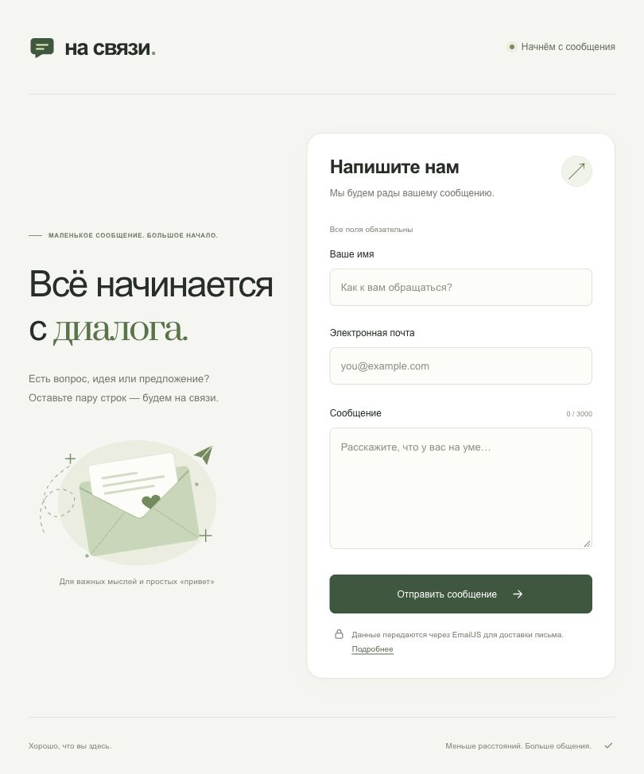

# Отчёт по развёртыванию статического сайта в Nginx и Docker

**ФИО:** Иванов Андрей Александрович

**Группа:** 5-МВ-5

**Проект:** «На связи» — форма обратной связи

**Технологии:** HTML, CSS, JavaScript, Nginx, Docker Compose

**Адрес по умолчанию:** http://localhost:8080

**Адрес при проверке:** http://localhost:18080

**Среда проверки:** macOS, Docker Desktop

## Цель работы

Развернуть статический сайт в контейнере Nginx, настроить запуск через Docker Compose и обновление файлов сайта без пересборки образа.

## Структура проекта

```text
emailJSContactForm/
├── Dockerfile
├── compose.yaml
├── nginx.conf
├── .dockerignore
├── README.md
├── REPORT.md
├── DEMO.md
└── public/
    ├── index.html
    ├── styles.css
    ├── app.js
    ├── config.js
    ├── favicon.svg
    └── vendor/
        ├── emailjs.min.js
        └── EMAILJS-LICENSE.txt
```

Дополнительные `package.json`, `scripts/` и `firebase.json` сохранены для альтернативного запуска исходного сайта. Контейнер Nginx их не использует.

## Настройка образа и контейнера

В `Dockerfile` используется официальный образ `nginx:alpine`. Команды `COPY` добавляют конфигурацию Nginx и папку `public/` в образ. Директива `EXPOSE 80` описывает порт веб-сервера; публикация порта на компьютере задаётся отдельно в Compose.

В `compose.yaml` описан сервис `web`. Docker Compose собирает образ `na-svyazi-static:local` из текущей папки и по умолчанию публикует порт `8080:80`: запрос к порту 8080 компьютера направляется на порт 80 контейнера. Порт компьютера можно изменить переменной `SITE_PORT` в локальном `.env`. При проверке использован порт 18080, потому что 8080 уже занят. Политика `restart: unless-stopped` обеспечивает повторный запуск контейнера, если он не был остановлен вручную.

Папка `./public` подключается в `/usr/share/nginx/html`, а `./nginx.conf` — в `/etc/nginx/conf.d/default.conf`. Оба bind mount используют режим `:ro`: контейнер может читать эти файлы, а редактирование выполняется на компьютере. Подключена вся папка сайта, чтобы сохранение файлов редактором не нарушало обновление содержимого.

В `nginx.conf` заданы корневая папка сайта, стартовая страница `index.html` и кодировка UTF-8. `sendfile off` отключает оптимизированную отправку файлов, а заголовок `Cache-Control: no-store` запрещает браузеру сохранять ответы в кэше. Для несуществующих файлов сервер возвращает HTTP 404.

## Запуск

После запуска Docker Desktop команды выполняются из корня проекта:

```bash
docker version
docker compose version
docker compose up --build -d
docker compose ps
docker compose exec web nginx -t
```

Команда `docker compose up --build -d` собирает образ и запускает контейнер в фоновом режиме. Сайт открывается в браузере по адресу http://localhost:8080 или по выбранному в `.env` порту. Команда `docker compose logs -f web` показывает обращения к Nginx, а `docker compose down` останавливает и удаляет контейнер проекта.

При подготовке Docker Hub возвращал сетевой таймаут. Для сборки использована копия официального `nginx:alpine` из кэширующего зеркала `mirror.gcr.io`; порядок загрузки описан в README. Dockerfile сохраняет стандартное имя базового образа.

## Проверка работы

Порядок проверки:

1. Открыть главную страницу и проверить загрузку оформления, иллюстрации и JavaScript.
2. Выполнить `docker compose exec web nginx -t` и проверить успешную проверку конфигурации.
3. В `public/index.html` изменить текст `Мы будем рады вашему сообщению.` на `Привет из Nginx в Docker!`, сохранить файл и обновить страницу. Изменения должны отобразиться без пересборки и перезапуска контейнера.
4. Проверить заголовки ответа командой `curl -I http://localhost:18080/`. В Windows PowerShell можно использовать `curl.exe -I http://localhost:18080/`. Ожидаются статус `200 OK`, сервер Nginx и заголовок `Cache-Control: no-store`. Если используется стандартный порт, заменить 18080 на 8080.
5. Открыть http://localhost:18080/not-found.html и проверить ответ 404.

Форма проверяет обязательные поля и формат электронной почты. Поскольку параметры EmailJS в `public/config.js` не заполнены, отправка писем не подключена. Это отдельная настройка внешнего сервиса; раздача файлов через Nginx работает независимо от неё.

## Полученные результаты

Проверка выполнена 9 ноября 2026 года на macOS в Docker Desktop. Образ собран из Dockerfile, сервис `web` запущен с пробросом порта `18080:80`. Конфигурация Nginx успешно прошла `nginx -t`.

| Проверка | Результат |
| --- | --- |
| Главная страница | HTTP 200, кодировка UTF-8 |
| HTML, CSS, JavaScript, SVG и локальный EmailJS SDK | Успешная загрузка, правильные MIME-типы; содержимое ответов совпадает с файлами в `public/` |
| Кэширование | Во всех проверенных ответах присутствует `Cache-Control: no-store` |
| Несуществующая страница | HTTP 404 |
| Изменение файла в папке на компьютере | Новое содержимое получено без пересборки и перезапуска контейнера; задержка синхронизации составила около 0,1 секунды |

Для проверки bind mount в `public/` был создан временный текстовый файл. После получения исходной версии файл изменён на компьютере и повторно запрошен по HTTP. Nginx вернул новое содержимое. По окончании проверки временный файл удалён.

Статус контейнера и вывод команд сохранены в [evidence/docker-status.txt](./evidence/docker-status.txt), результаты HTTP-проверки — в [evidence/http-verification.txt](./evidence/http-verification.txt).

Снимок страницы работающего сайта:



## Вывод

Статический сайт развёрнут в контейнере Nginx и запускается через Docker Compose. Подключение папки сайта через bind mount позволяет редактировать файлы на компьютере и видеть изменения после обновления страницы без пересборки образа. Порт компьютера можно выбрать в локальном `.env`.

## Материалы для демонстрации

Сценарий демонстрации находится в [DEMO.md](./DEMO.md). В видео можно показать запуск контейнера, открытие сайта, изменение HTML и обновление страницы без перезапуска. Если для сдачи требуется видео, его нужно записать на своём компьютере и приложить к репозиторию как `screen.mp4`.

## Источники

- [Пример учебного проекта](https://github.com/Far4Ru/nginx_in_docker_static_site).
- [Официальный образ Nginx](https://hub.docker.com/_/nginx).
- [Документация Docker Compose](https://docs.docker.com/compose/gettingstarted/).
